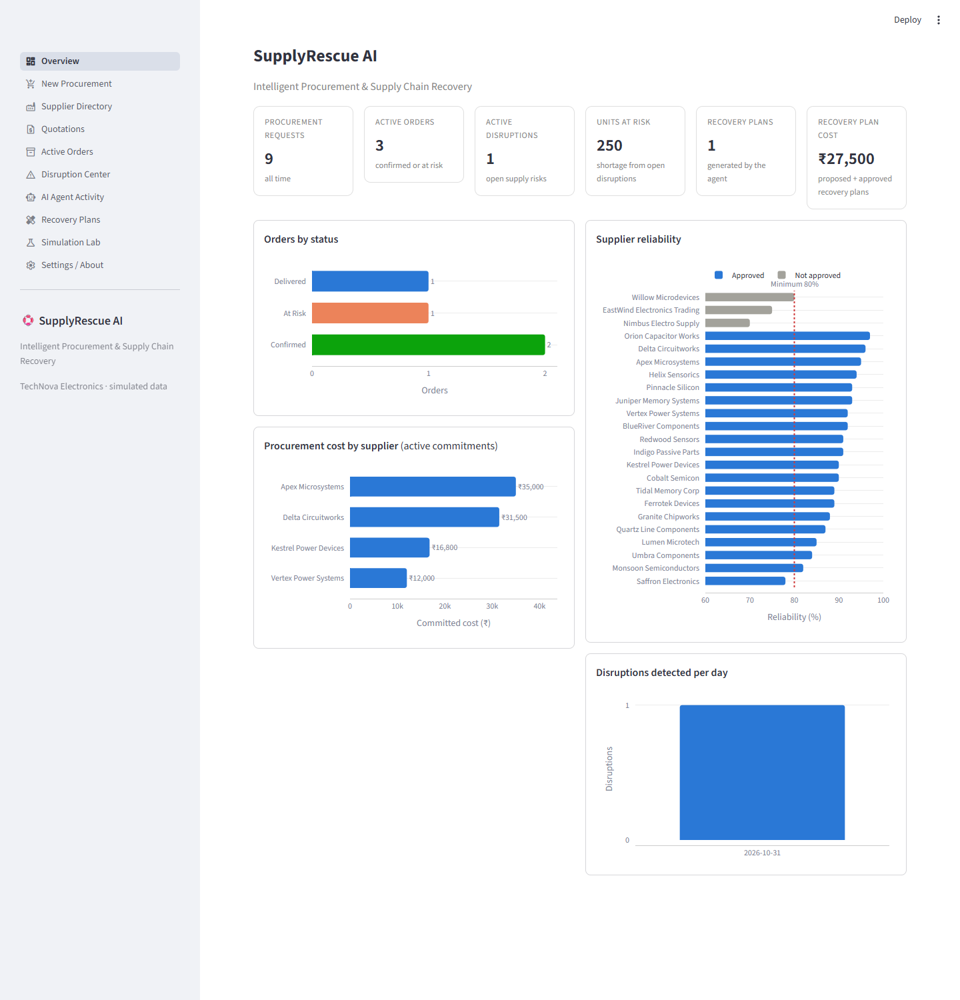
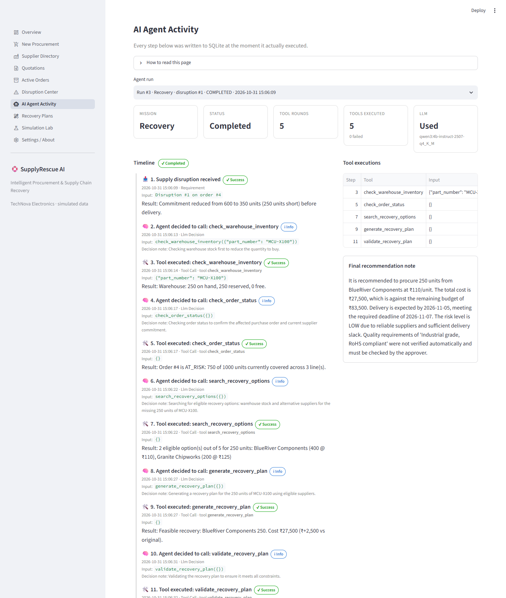
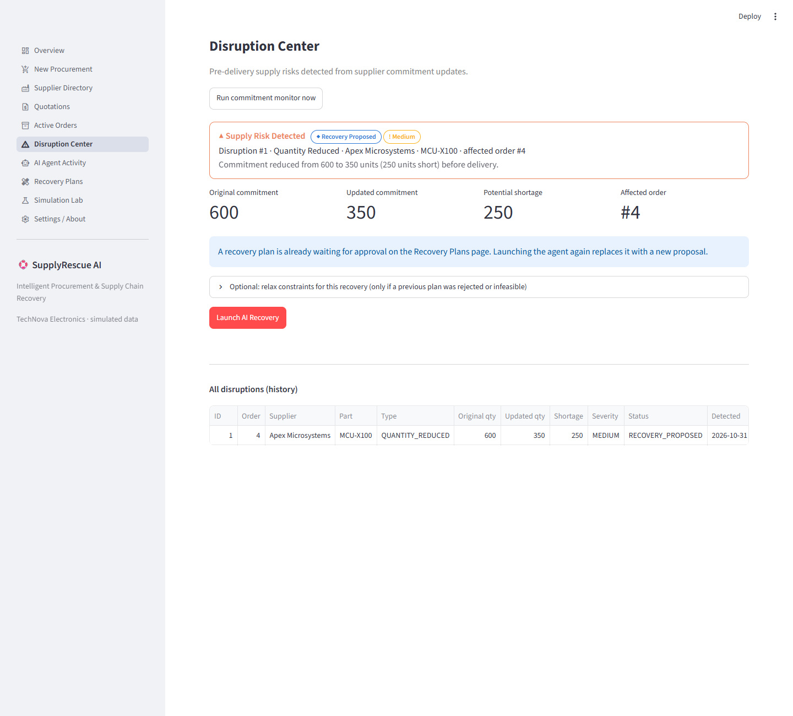
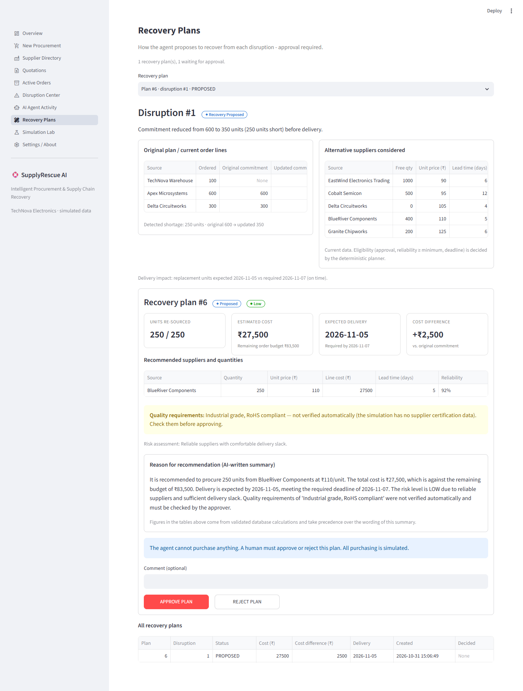
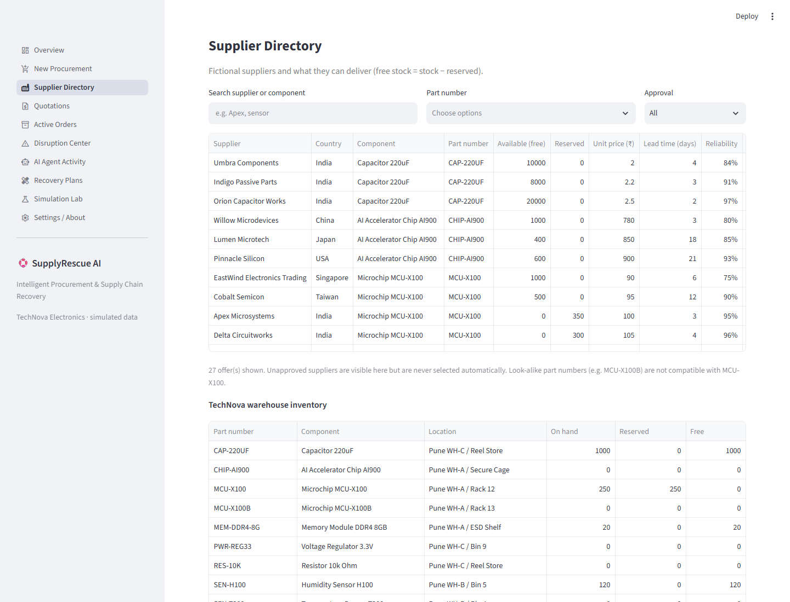
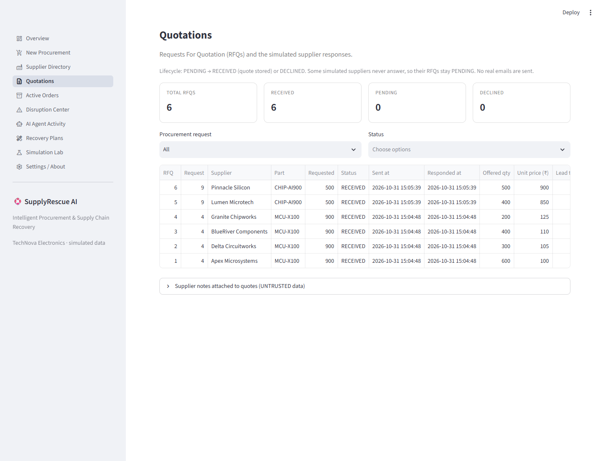

# SupplyRescue AI

[](https://github.com/Anshupadhyay1419/SupplyRescue-AI/actions/workflows/tests.yml)

**An Agentic AI System for Intelligent Procurement and Supply Chain Disruption Management**

*Intelligent Procurement & Supply Chain Recovery* — runs 100% locally with Ollama, LangGraph, SQLite and Streamlit. No paid or cloud APIs.

> **Simulation disclaimer:** TechNova Electronics and all suppliers are fictional. RFQs, quotations, purchase orders and supplier events are simulated in SQLite. No email is sent, no real purchase order is placed and no payment is processed.

---

## 1. Problem statement

Procurement teams in electronics manufacturing must repeatedly: check stock, find qualified suppliers, request quotations, compare price/lead-time/reliability, split orders, get approval, and then **watch confirmed orders for problems**. When a supplier silently cuts a confirmed quantity a few days before delivery, someone has to notice, work out the shortage and find a replacement before the production deadline. This is slow, manual and error-prone.

## 2. Proposed solution

SupplyRescue AI is a tool-using **AI agent** (one LangGraph agent driven by a local Qwen3 model) that:

1. Investigates a procurement requirement with tools (warehouse, supplier search, RFQs, quotations, planning, validation).
2. Recommends a lowest-cost plan that satisfies every hard rule — computed by deterministic Python, never by the LLM.
3. Waits for **human approval** before anything is "purchased" (simulated).
4. Monitors supplier commitments, **detects pre-delivery disruptions** from observable supplier signals, and
5. Runs a **recovery mission**: re-plans the missing units, validates the plan, and again asks a human to approve.

## 3. Main features

| Area | What is implemented |
|---|---|
| Agent | LangGraph state machine, LLM tool selection (`ChatOllama.bind_tools`), bounded loop (max iterations), tool timeouts, structured tool results, safe fallback when Ollama is down |
| Planning | Exact part-number matching, approved suppliers only, reliability minimum, deadline + budget checks, warehouse-first + cheapest-first allocation, multi-supplier splitting, infeasibility explanations |
| Quotations | Simulated RFQ lifecycle (PENDING → RECEIVED / DECLINED), deterministic supplier behaviours, untrusted supplier text (includes a prompt-injection test) |
| Approval | APPROVE / REJECT with atomic transactions, duplicate-approval protection, re-validation at approval time, stock reservation, revised requests after rejection |
| Disruptions | Quantity reduction, cancellation, delivery delay, price increase — detected from `supplier_updates` signals |
| Recovery | Alternative suppliers + warehouse, cost difference, delivery impact, optional human-approved budget/deadline relaxation, honest "No feasible recovery plan" reports |
| Dashboard | 10 Streamlit pages incl. live agent timeline, KPIs and Plotly charts |
| Quality | 67 unit tests (no Ollama needed) + 3 real-Ollama integration tests, GitHub Actions CI |

## 4. Technology stack

Python 3.10+ · Streamlit · LangGraph · langchain-ollama · Ollama (`qwen3:4b-instruct-2507-q4_K_M`) · SQLite · Pandas · Plotly · python-dotenv · pytest · Python `logging`

## 5. System architecture

```
┌────────────────────────── Streamlit dashboard (ui/) ──────────────────────────┐
│ Overview · New Procurement · Suppliers · Quotations · Orders · Disruptions ·  │
│ Agent Activity · Recovery Plans · Simulation Lab · Settings                   │
└───────────────┬──────────────────────────────────────────────┬────────────────┘
                │ run agent                                    │ approve / reject / simulate
                ▼                                              ▼
┌──── LangGraph agent (agents/) ────┐          ┌──── Services (services/) ──────────┐
│ understand → agent ⇄ tools →      │  tools   │ planning (allocation + validation)  │
│ finalize → explain → approval req.│ ───────► │ procurement · quotations · approval │
│        ▲ LLM (Ollama, local)      │ (tools/) │ disruption detection · recovery     │
└───────────────────────────────────┘          │ simulation engine                   │
                                               └───────────────┬─────────────────────┘
                                                               ▼
                                                SQLite (database/) – 17 tables
```

* **LLM decides** which tool to call next and writes explanations.
* **Python calculates** quantities, costs, deadlines and validity.
* **Humans approve**. The agent has no tool that can approve or purchase.

See [docs/ARCHITECTURE.md](docs/ARCHITECTURE.md) for details.

## 6. Agent workflow

```
START → understand_requirement ─(invalid)→ END
              │
              ▼
           agent (LLM) ──tool calls──► tools ──┐
              ▲                                │  (≤ AGENT_MAX_ITERATIONS rounds)
              └────────────────────────────────┘
              │ final answer / limit reached / LLM down
              ▼
        finalize_plan (authoritative plan + validation checklist)
              ▼
        explain_recommendation (LLM explains validated facts)
              ▼
        request_human_approval (plan saved as PROPOSED or INFEASIBLE) → END
```

Full node-by-node explanation: [docs/AGENT_WORKFLOW.md](docs/AGENT_WORKFLOW.md).

## 7. Screenshots

Real captures of the running app (live Ollama agent runs; MCU-X100 order approved, then Apex cut 600 → 350).

**Overview** — KPIs and charts computed from SQLite


**AI Agent Activity** — the recovery agent's real tool calls, decision notes and results


**Disruption Center** — pre-delivery shortage detected from the supplier's commitment update


**Recovery Plans** — before/after, alternatives, validated plan, quality warning, human approval


**Supplier Directory** and **Quotations**



## 8. Installation (Windows 11)

```powershell
# 1. Open PowerShell in the project folder
cd "D:\bennett\Agnetic ai\supplyrescue-ai"

# 2. Create and activate a virtual environment
py -3.10 -m venv .venv
.\.venv\Scripts\Activate.ps1
#   (if activation is blocked: Set-ExecutionPolicy -Scope CurrentUser RemoteSigned)

# 3. Install dependencies
python -m pip install --upgrade pip
pip install -r requirements.txt

# 4. Optional: copy the configuration template
copy .env.example .env
```

## 9. Ollama setup

```powershell
ollama list                                   # check installed models
ollama pull qwen3:4b-instruct-2507-q4_K_M     # only if it is missing
python scripts\verify_tool_calling.py         # must print "PASS - structured tool call received"
```

The model is set in `.env` (`OLLAMA_MODEL`). A backup (`qwen3:4b`) is configured but is **never** switched to silently — change `.env` yourself if needed and re-run the verification script with the model name as argument.

## 10. Database setup

The database is created and seeded automatically on first start. To reset it manually:

```powershell
python -m database.seed
```

The demo database (`data/supplyrescue.db`) is git-ignored; it is always rebuilt from `database/seed.py`. The **Reset Demo** button in the Simulation Lab does the same.

## 11. Start the application

```powershell
.\.venv\Scripts\Activate.ps1
streamlit run app.py
```

Open http://localhost:8501.

## 12. Demo scenarios

| # | Scenario | How |
|---|---|---|
| S1 | Normal procurement | Run agent on the CAP-220UF request |
| S2 | Partial supplier availability | Run agent on SEN-T200 (no single supplier has 800) |
| S3 | Pre-delivery disruption | Approve MCU-X100 plan → Simulation Lab → Partial Supply 600 → 350 |
| S4 | Supplier cancellation | Simulation Lab → Supplier Cancellation |
| S5 | Budget constraint | Run agent on MEM-DDR4-8G (cheapest = ₹261,000 > ₹200,000) |
| S6 | Deadline constraint | Run agent on RES-10K (cheapest supplier needs 14 days) |
| S7 | No feasible solution | Run agent on CHIP-AI900 (approved suppliers too slow, fast one unapproved) |
| S8 | Multiple supplier allocation | Run agent on MCU-X100 (warehouse 100 + Apex 600 + Delta 300) |

Step-by-step professor script: [docs/DEMO_GUIDE.md](docs/DEMO_GUIDE.md).

## 13. Testing

```powershell
pytest                 # 67 unit tests, no Ollama required (~20 s) - also run by GitHub Actions
pytest -m ollama -v    # 3 integration tests against the real local model (~3-5 min)
```

## 14. Limitations

* All supplier communication and purchasing is simulated; there are no real integrations.
* The allocation is provably minimum-cost only under linear per-unit pricing (no minimum order quantities, volume discounts or shipping fees). Adding those would make it a heuristic.
* Warehouse stock is treated as zero procurement cost (it is already owned).
* A 4B local model is slower (~50-60 s per run on an RTX 3050) and its wording can be imperfect; that is why every number comes from Python and the UI marks the AI text as a summary.
* **Quality requirements are not verified.** They are stored, shown to the approver with a warning, and passed to the LLM with an explicit "not verified" note — but the simulation has no supplier certification data, so the system never claims a supplier meets them.
* A timed-out tool thread cannot be killed in Python. It keeps running in the background, but it can no longer save anything (see *Tool timeouts* in [docs/ARCHITECTURE.md](docs/ARCHITECTURE.md)).
* Single-user local app; SQLite locking is sufficient but not designed for many concurrent users.

## 15. Future improvements

* Real supplier APIs / email parsing for RFQs (with the same untrusted-data handling).
* Supplier MOQ, volume discounts and logistics costs with an exact solver (e.g. OR-Tools) once the model is non-linear.
* Delivery tracking (DELIVERED status per commitment) and goods-receipt workflow.
* Role-based approval limits (e.g. manager approval above a cost threshold).
* Scheduled background monitoring instead of on-demand monitor runs.

## Project structure

```
supplyrescue-ai/
├── app.py                 Streamlit entry point + navigation
├── config/settings.py     All configuration (reads .env)
├── database/              connection, schema (17 tables), seed data, read queries
├── services/              deterministic business logic (no LLM)
├── tools/                 LangChain tools the agent can call
├── agents/                LangGraph state, nodes, graph, activity log
├── ui/                    shared components + 10 pages
├── utils/                 logging, validation, formatting, tool cancellation token
├── scripts/               verify_tool_calling.py
├── tests/                 pytest suite
├── docs/                  architecture, explanation, workflow, demo guide, screenshots
└── .github/workflows/     CI: runs pytest (no Ollama) on every push
```
